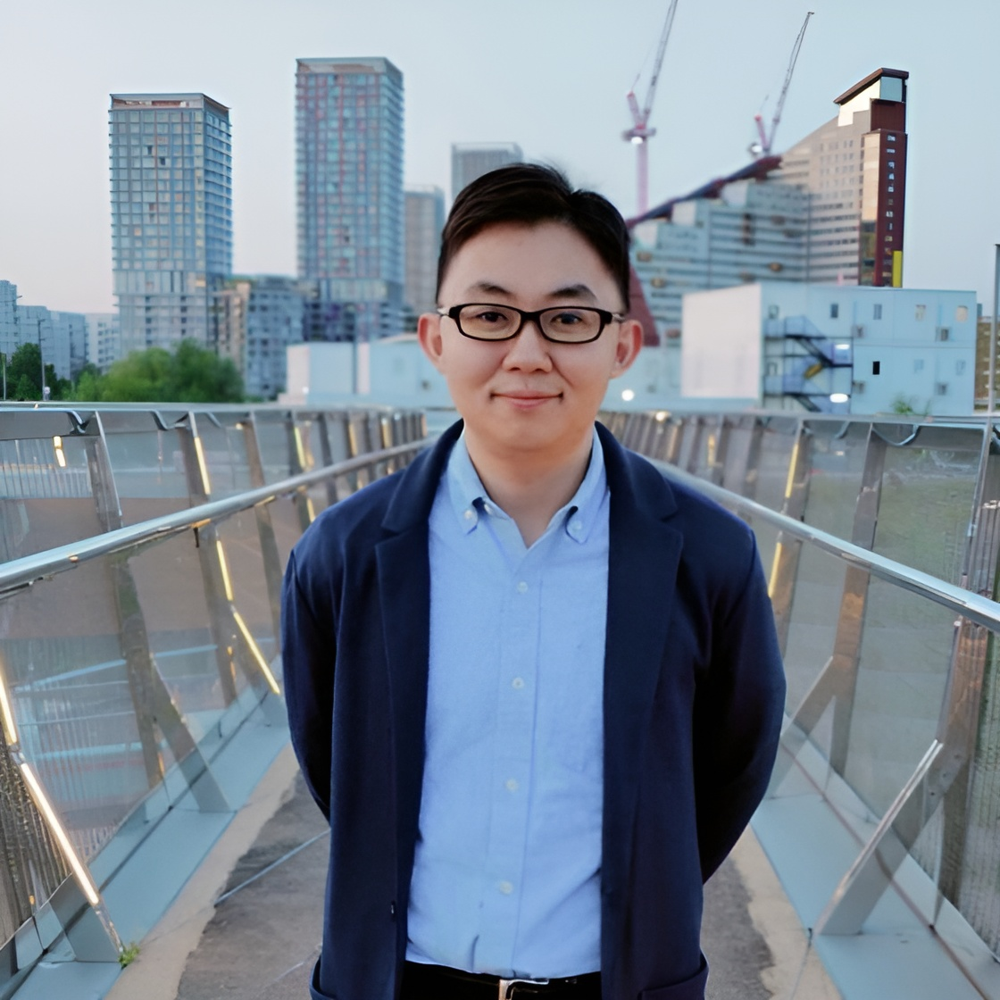
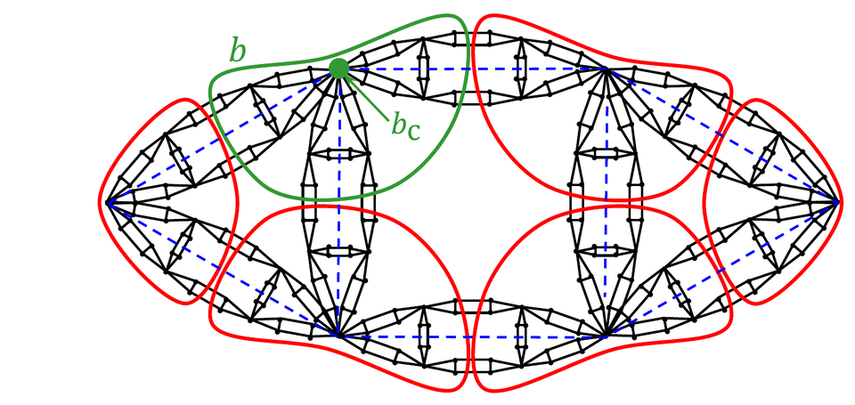
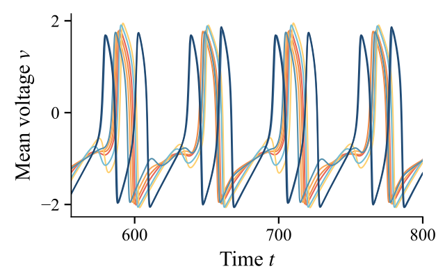

:::: {.home-intro}
::: {.home-intro__copy}

Network science · Statistical physics

<h1>Jun Yamamoto</h1>

PhD candidate in Network Science

Department of Network and Data Science Central European University · Vienna, Austria

I am a theoretical network scientist, investigating the organizing principles of network structures and dynamics using statistical physics. 
My active research topics include physical networks, network coarse-graining and fractality, and network diffusion and synchronization.

<a class="button-link button-link--primary" href="research.qmd">Explore research</a>
<a class="button-link" href="assets/cv_jyamamoto.pdf">CV (PDF)</a>
<a class="button-link" href="publications.qmd">Publications</a>
<a class="button-link" href="mailto:jun.j.yamamoto@gmail.com">Email</a>



:::
::: {.home-intro__photo}

:::
::::

## Research

::: {.section-intro}
My research focuses on the structure and dynamics of physical and fractal networks, exploring how network topology and geometry influence transport and collective behavior.
:::

:::: {.theme-grid}
::: {.theme-card}
<figure>

</figure>

### [Physical networks](research.qmd#physnets)

How do network connectivity and spatial layout jointly shape transport and dynamic response?

[More details](research.qmd#physnets){.theme-card__link .button-link .button-link--compact}
:::

::: {.theme-card}
<figure>

</figure>

### [Fractal networks](research.qmd#netscale)

How do fractal property and scales impact network structure and function?

[More details](research.qmd#netscale){.theme-card__link .button-link .button-link--compact}
:::

::: {.theme-card}
<figure>

</figure>

### [Network synchronization](research.qmd#netsync)

How do synchronization patterns emerge in complex networks?

[More details](research.qmd#netsync){.theme-card__link .button-link .button-link--compact}
:::
::::

:::: {.home-support}
::: {.home-background}

## Education

<ul class="education-list">
<li><strong>PhD in Network Science</strong>In progress · Central European University Vienna, Austria</li>
<li><strong>MSc in Mathematics</strong>2023 · Queen Mary University of London London, UK</li>
<li><strong>BEng in Applied Physics</strong>2022 · Hokkaido University Sapporo, Japan</li>
</ul>

::: {.supervisors}
I am supervised by Prof. [Márton Pósfai](https://people.ceu.edu/marton_posfai) and Prof. [János Kertész](https://people.ceu.edu/janos_kertesz).
:::

<a class="button-link button-link--compact" href="https://researchmap.jp/jun_yamamoto">researchmap</a>

:::

::: {.home-news}

## News

<ul class="news-list">
<li><time datetime="2026-09-07">7 September 2026</time>Presented structural crossover in critical random networks at the <a href="https://colibri.uni-graz.at/en/complexity-of-life-conference-2026/">Complexity of Life Conference</a>, University of Graz, Austria.</li>
<li><time datetime="2026-07-16">16 July 2026</time>Co-organized a networking event for Japanese researchers in Austria at the Official Residence of the Japanese Ambassador in Vienna.</li>
<li><time datetime="2026-06">June–July 2026</time>Visited the <a href="https://barabasi.com/science">Barabási Lab</a> at Northeastern University as an <a href="https://www.accelnet-multinet.org/">AccelNet-MultiNet fellow</a>.</li>
<li><time datetime="2026-06-02">2 June 2026</time>Co-organized <a href="https://sites.google.com/view/physnet26">Physical Networks IV</a>, a NetSci satellite in Boston.</li>
<li><time datetime="2026-02-17">17 February 2026</time>Presented a poster on Laplacian eigenmode localization at the <a href="https://www.network-science-seminar.com/activities/2025">Network Science Seminar</a> in Kyoto, Japan.</li>
</ul>
:::
::::
