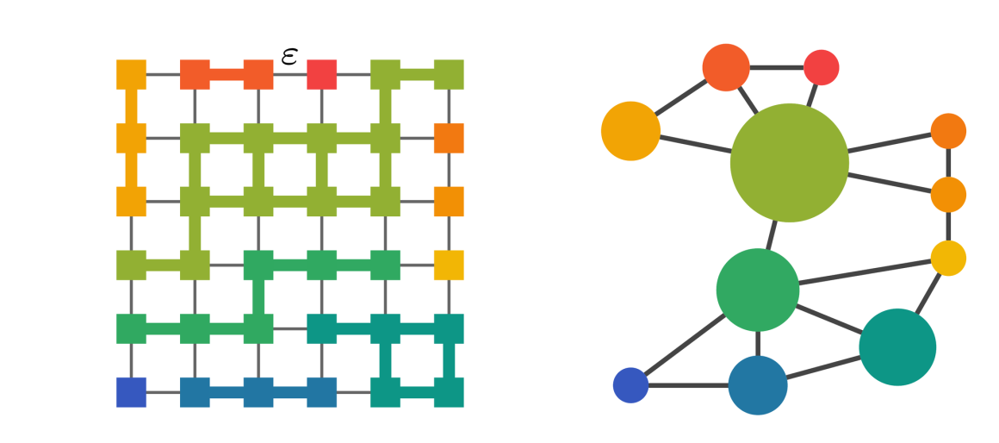
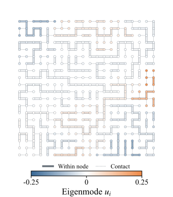
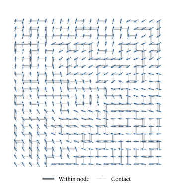
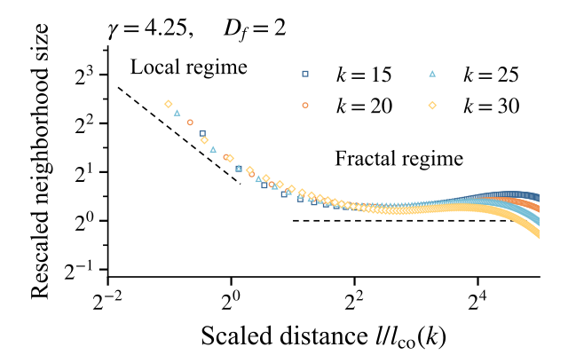
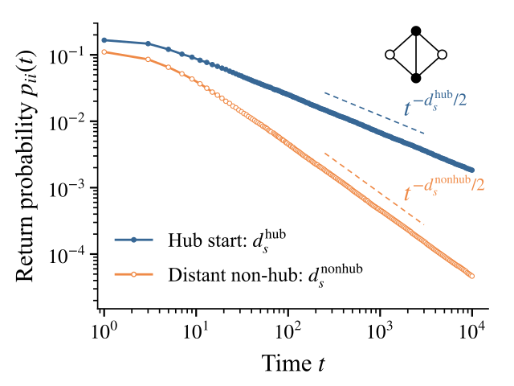
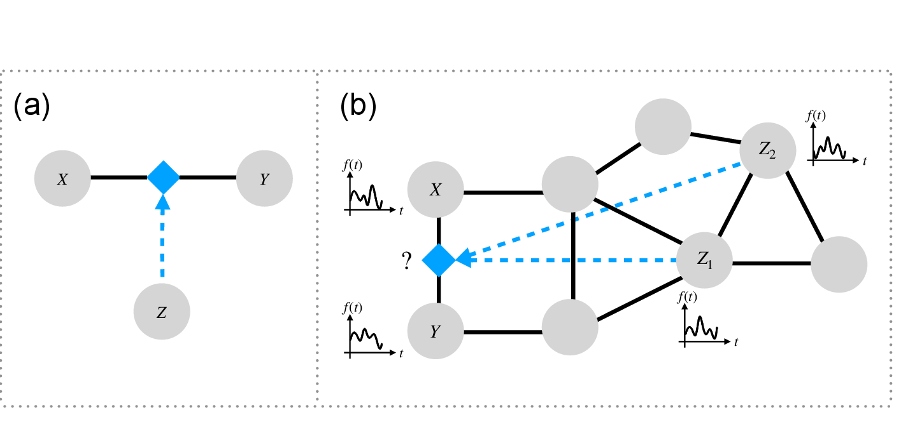

::: {#current-projects .research-introduction .page-introduction}
I study the structure and dynamics of physical networks embedded in low-dimensional Euclidean space, and of networks with finite fractal dimension defined by shortest-path box covering. 
These two directions bridge network topology, geometry, and dynamics.
:::

<nav class="research-overview-links" aria-label="Research sections">
  <a class="research-overview-link" href="#physnets">
    Physical networks
    <svg aria-hidden="true" focusable="false" viewBox="0 0 16 16"><path d="M8 3v10m-4-4 4 4 4-4"/></svg>
  </a>
  <a class="research-overview-link" href="#netscale">
    Fractal networks
    <svg aria-hidden="true" focusable="false" viewBox="0 0 16 16"><path d="M8 3v10m-4-4 4 4 4-4"/></svg>
  </a>
</nav>

::::: {.research-program}

## Physical networks {#physnets}

::: {.research-program__lead}
Physical networks with spatially extended components are embedded in low-dimensional Euclidean space.
I investigate how spatial and physical constraints shape network topology, node properties, and collective dynamics.
:::

### Structural properties {#physnets-structure}

:::: {.research-topic-row}
::: {.research-topic-row__body}

How does spatial organization couple network topology with physical node properties?

I study **degree–volume correlations**, the relationship between a physical node's size and the number and strength of its connections, commonly observed in many empirical physical networks. 
These correlations relate physical constraints with network representations and provide the starting point for models of transport and collective dynamics in physical complex systems [@yamamoto2026localization; @yamamoto2026laplacian].

<!-- 
::: {.research-actions}
[Preprint](https://doi.org/10.48550/arXiv.2607.19486){.button-link .button-link--compact}
::: 
-->
:::

::: {.research-topic-row__visual}
<figure class="research-figure">
  
  <figcaption>Microscopic subnetworks (left) and their coarse-grained network (right).</figcaption>
</figure>
:::
::::

### Dynamics {#physnets-dynamics}

I investigate how network physicality shapes diffusion, localization, and synchronization.

:::: {.research-topic-row}
::: {.research-topic-row__body}

#### Diffusion and localization {#physical-diffusion}

Preprint / submitted manuscripts

When do physical constraints trap diffusion modes, and when do those modes spread across a network?

A node's volume affects how long it stores flow before passing it on. We identify the ratio of degree to volume as the local disorder variable organizing Laplacian eigenmode localization in physical networks. Solvable models, random networks, and empirical physical networks show how degree–volume correlations reorganize modes that topology alone would predict [@yamamoto2026localization; @yamamoto2026laplacian].

::: {.research-actions}
[Preprint](https://doi.org/10.48550/arXiv.2607.19486){.button-link .button-link--compact}
:::
:::

::: {.research-topic-row__visual}
<figure class="research-figure">
  
  <figcaption>An eigenmode on the network-of-networks model.</figcaption>
</figure>
:::
::::

:::: {.research-topic-row}
::: {.research-topic-row__body}

#### Synchronization {#netsync}

Ongoing work

How does physical network structure shape synchronization patterns?

I study the emergence of synchronization in coupled oscillator networks with physical constraints. 
I collaborate with an [experimental spintronics group](https://www.akermanlab.com/) on **spin Hall nano-oscillators**.

Further details will be shared when the preprint is available on arXiv.

:::

::: {.research-topic-row__visual}
<figure class="research-figure">
  
  <figcaption>Illustrative oscillator phases.</figcaption>
</figure>
:::
::::

:::::

::::: {.research-program}

## Fractal networks {#netscale}

::: {.research-program__lead}
I study complex networks with finite fractal dimensions defined through the scaling of the minimal number of boxes (subgraphs) of a given diameter needed to cover the network.
My work examines how these dimensions depend on position and observation scale, and how they govern transport.
:::

### Structural properties {#netscale-structure}

:::: {.research-topic-row}
::: {.research-topic-row__body}

Published work / preprint

How can the coexistence of fractal and scale-free properties impact network structures, and how do network structures change across scales?

**Bifractality.** We identified two distinct local fractal dimensions in a broad range of fractal scale-free networks: one near hubs and another away from them. Analytical and numerical results suggest that this bifractality is a general property of networks possessing scale-free topology with fractal structure [@yamamoto2023bifractality].

**Structural crossover.** In critical random networks, neighborhood growth exhibits a crossover from a degree-dependent local regime to global fractal scaling. We derive this crossover from long-range degree correlations in the infinite incipient cluster at the percolation threshold [@mizutaka2026structural].

::: {.research-actions}
[Bifractality paper](https://doi.org/10.1103/PhysRevE.108.024302){.button-link .button-link--compact}
[Crossover preprint](https://doi.org/10.48550/arXiv.2610.02883){.button-link .button-link--compact}
:::
:::

::: {.research-topic-row__visual}
<figure class="research-figure">
  
  <figcaption>Crossover from local degree dependence to global fractal scaling.</figcaption>
</figure>
:::
::::

### Dynamics {#netscale-dynamics}

:::: {.research-topic-row}
::: {.research-topic-row__body}

#### Random walks {#network-random-walks}

Published · Physical Review E · 2024

How does local fractal geometry affect random walks?

Our work on random walks connects structural bifractality to **two local spectral dimensions**, while the walk dimension remains position-independent. The spectral dimension governs the decay of the return-to-origin probability, $P_i(t) \propto t^{-d_{\mathrm{s}}(i)/2}$. Walks starting at hubs and at distant non-hub nodes therefore exhibit distinct local transport properties in the large-network limit [@yakubo2024random].

::: {.research-actions}
[Paper](https://doi.org/10.1103/PhysRevE.110.064318){.button-link .button-link--compact}
[arXiv](https://doi.org/10.48550/arXiv.2407.16183){.button-link .button-link--compact}
:::
:::

::: {.research-topic-row__visual}
<figure class="research-figure">
  
  <figcaption>Hub and distant non-hub return probabilities reveal two local spectral dimensions. Dashed lines show theoretical slopes.</figcaption>
</figure>
:::
::::

:::::

## Past projects {#past-project}

::: {.research-section-lead}
Here I summarize other research projects I have worked on. See [Publications](publications.qmd) for the full list.
:::

:::: {.research-project}
::: {.research-project__body}

PublishedNature Communications · 2025

### Mining triadic interactions {#triadic-interactions}

In a triadic interaction, a node influences the connection between two other nodes. 
We developed a method to identify candidate triadic interactions by measuring how mutual information between two node states varies with a third node’s state, with significance assessed against null models [@niedostatek2025mining].

::: {.research-actions}
[Paper](https://doi.org/10.1038/s41467-025-66577-z){.button-link .button-link--compact}
[arXiv](https://doi.org/10.48550/arXiv.2404.14997){.button-link .button-link--compact}
[Code](https://github.com/anthbapt/trim){.button-link .button-link--compact}
:::
:::

::: {.research-project__visual}
<figure class="research-figure">
  
  <figcaption>Structural and regulatory layers of a triadic-interaction network.</figcaption>
</figure>
:::
::::
