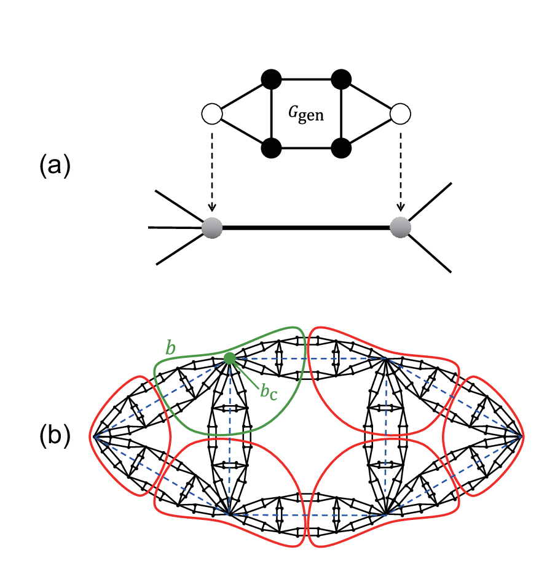
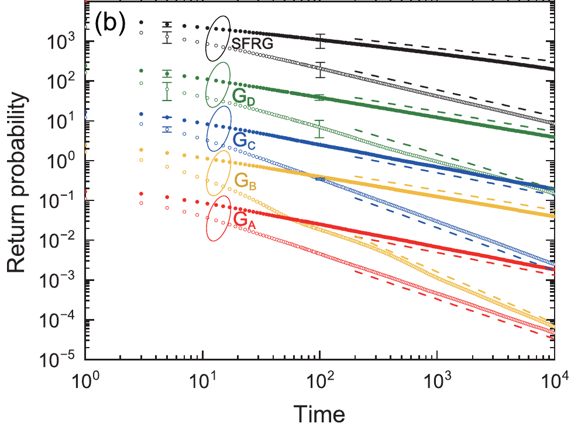

::: {#current-projects .research-introduction .page-introduction}
I study the structure and dynamics of physical networks embedded in low-dimensional Euclidean space, and of fractal networks with finite dimension. These two directions connect spatial constraints and network geometry to transport and collective behavior.
:::

<nav class="research-overview-links" aria-label="Research sections">
  <a class="research-overview-link" href="#physnets">
    Physical networks
    <svg aria-hidden="true" focusable="false" viewBox="0 0 16 16"><path d="M8 3v10m-4-4 4 4 4-4"/></svg>
  </a>
  <a class="research-overview-link" href="#netscale">
    Fractal networks
    <svg aria-hidden="true" focusable="false" viewBox="0 0 16 16"><path d="M8 3v10m-4-4 4 4 4-4"/></svg>
  </a>
</nav>

::::: {.research-program}

## Physical networks {#physnets}

::: {.research-program__lead}
Physical networks are embedded in low-dimensional Euclidean space.
I investigate how spatial and physical constraints shape their connectivity, node volumes, and dynamics.
:::

### Structural properties {#physnets-structure}

:::: {.research-topic-row}
::: {.research-topic-row__body}

How does spatial organization connect network topology with physical node size?

I study **degree–volume correlations**: how a physical node's volume relates to the number and strength of its connections. These structural relations connect physical constraints with coarse-grained network representations and provide the starting point for models of transport and collective dynamics [@yamamoto2026localization; @yamamoto2026laplacian].

::: {.research-actions}
[Physical-network preprint](https://doi.org/10.48550/arXiv.2607.19486){.button-link .button-link--compact}
:::
:::

::: {.research-topic-row__visual}
<figure class="research-figure">
  
  <figcaption>Microscopic subnetworks (left) and their coarse-grained network (right).</figcaption>
</figure>
:::
::::

### Dynamics {#physnets-dynamics}

I investigate how physical heterogeneity shapes diffusion, localization, mechanical response, and synchronization.

:::: {.research-topic-row}
::: {.research-topic-row__body}

#### Diffusion and localization {#physical-diffusion}

Preprint / submitted manuscripts

When do physical constraints trap diffusion modes, and when do those modes spread across a network?

A node's volume affects how long it stores flow before passing it on. We identify the ratio of degree to volume as the local disorder variable organizing Laplacian eigenmode localization in physical networks. Solvable models, random networks, and empirical physical networks show how degree–volume correlations reorganize modes that topology alone would predict [@yamamoto2026localization; @yamamoto2026laplacian].

::: {.research-actions}
[Preprint](https://doi.org/10.48550/arXiv.2607.19486){.button-link .button-link--compact}
:::
:::

::: {.research-topic-row__visual}
<figure class="research-figure">
  
  <figcaption>An eigenmode on the network-of-networks model.</figcaption>
</figure>
:::
::::

:::: {.research-topic-row}
::: {.research-topic-row__body}

#### Synchronization {#netsync}

Ongoing work

How does physical network structure shape synchronization patterns?

I study the emergence of synchronization in coupled oscillator networks. I also collaborate with experimentalists on **spin Hall nano-oscillators**.

Further details will be shared when the preprint is available on arXiv.

:::

::: {.research-topic-row__visual}
<figure class="research-figure">
  
  <figcaption>Illustrative oscillator phases.</figcaption>
</figure>
:::
::::

:::::

::::: {.research-program}

## Fractal networks {#netscale}

::: {.research-program__lead}
I study fractal networks with finite dimensions defined through scaling with shortest-path distance. My work examines how these dimensions depend on position and observation scale, and how they govern transport.
:::

### Structural properties {#netscale-structure}

:::: {.research-topic-row}
::: {.research-topic-row__body}

Published work / preprint

How can one network have different local dimensions, and how does its structure change across scales?

**Bifractality.** We identified two distinct local fractal dimensions in a broad range of fractal scale-free networks: one near hubs and another away from them. Analytical and numerical results suggest that this bifractality is a general property of networks possessing scale-free topology with fractal structure [@yamamoto2023bifractality].

**Structural crossover.** In critical random networks, neighborhood growth exhibits a crossover from a degree-dependent local regime to global fractal scaling. We derive this crossover from long-range degree correlations in the infinite incipient cluster at the percolation threshold [@mizutaka2026structural].

::: {.research-actions}
[Bifractality paper](https://doi.org/10.1103/PhysRevE.108.024302){.button-link .button-link--compact}
[Crossover preprint](https://doi.org/10.48550/arXiv.2610.02883){.button-link .button-link--compact}
:::
:::

::: {.research-topic-row__visual}
<figure class="research-figure">
  
  <figcaption>Crossover from local degree dependence to global fractal scaling.</figcaption>
</figure>
:::
::::

### Dynamics {#netscale-dynamics}

:::: {.research-topic-row}
::: {.research-topic-row__body}

#### Random walks {#network-random-walks}

Published · Physical Review E · 2024

How does local fractal geometry affect a random walk's return probability?

Our work on random walks connects structural bifractality to **two local spectral dimensions**, while the walk dimension remains position-independent. The spectral dimension governs the decay of the return-to-origin probability, $P_i(t) \propto t^{-d_{\mathrm{s}}(i)/2}$. Walks starting at hubs and at distant non-hub nodes therefore exhibit distinct local transport properties [@yakubo2024random].

::: {.research-actions}
[Paper](https://doi.org/10.1103/PhysRevE.110.064318){.button-link .button-link--compact}
[arXiv](https://doi.org/10.48550/arXiv.2407.16183){.button-link .button-link--compact}
:::
:::

::: {.research-topic-row__visual}
<figure class="research-figure">
  
  <figcaption>Hub and distant non-hub return probabilities reveal two local spectral dimensions. Dashed lines show theoretical slopes.</figcaption>
</figure>
:::
::::

:::::

## Selected published work {#past-project}

::: {.research-section-lead}
Earlier results on network geometry, transport, and higher-order interactions. See [Publications](publications.qmd) for the full list.
:::

:::: {.research-project}
::: {.research-project__body}

PublishedPhysical Review E · 2023

### Bifractality of fractal scale-free networks {#bifractality}

We identified two distinct local fractal dimensions in a broad range of fractal scale-free networks: one near hubs and another away from them. Analytical and numerical results suggest this bifractality is a general property of networks combining scale-free connectivity with fractal structure [@yamamoto2023bifractality].

::: {.research-actions}
[Paper](https://doi.org/10.1103/PhysRevE.108.024302){.button-link .button-link--compact}
[arXiv](https://doi.org/10.48550/arXiv.2304.13438){.button-link .button-link--compact}
:::
:::

::: {.research-project__visual}
<figure class="research-figure">
  
  <figcaption>Generator construction and box covering for a bifractal network.</figcaption>
</figure>
:::
::::

:::: {.research-project}
::: {.research-project__body}

PublishedPhysical Review E · 2024

### Random walks on bifractal networks {#bifractal-random-walks}

Building on bifractality, we showed that the walk dimension remains position-independent while the spectral dimension takes two local values. These distinct structural environments leave a measurable signature in return-to-origin probabilities [@yakubo2024random].

::: {.research-actions}
[Paper](https://doi.org/10.1103/PhysRevE.110.064318){.button-link .button-link--compact}
[arXiv](https://doi.org/10.48550/arXiv.2407.16183){.button-link .button-link--compact}
:::
:::

::: {.research-project__visual}
<figure class="research-figure">
  
  <figcaption>Published return probabilities for bifractal networks, vertically offset for clarity.</figcaption>
</figure>
:::
::::

:::: {.research-project}
::: {.research-project__body}

PublishedNature Communications · 2025

### Mining triadic interactions {#triadic-interactions}

In a triadic interaction, a node influences the connection between two other nodes. We showed how these higher-order interactions can be inferred from diffusive dynamics using conditional correlations and mutual information between node triplets [@niedostatek2025mining].

::: {.research-actions}
[Paper](https://doi.org/10.1038/s41467-025-66577-z){.button-link .button-link--compact}
[arXiv](https://doi.org/10.48550/arXiv.2404.14997){.button-link .button-link--compact}
[Code](https://github.com/anthbapt/trim){.button-link .button-link--compact}
:::
:::

::: {.research-project__visual}
<figure class="research-figure">
  
  <figcaption>Structural and regulatory layers of a triadic-interaction network.</figcaption>
</figure>
:::
::::
